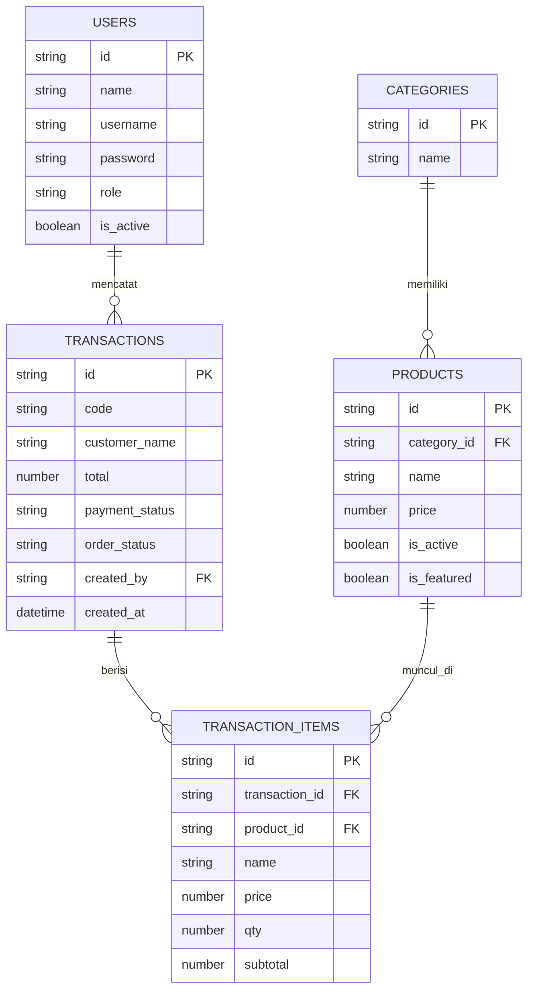

# Laporan Proyek — Sistem Informasi Manajemen Teh Tarik Pak Cik

**Mata kuliah:** Pemrograman Berbasis Komponen  
**Jenis proyek:** Aplikasi web single-page (SPA) untuk operasional warung  
**Teknologi:** Vue.js 3, Vue Router 4, Pinia 3, Vite 7  
**Penyimpanan data:** `localStorage` browser (data awal dari berkas JSON seed)  
**Status implementasi:** Selesai dan dapat dijalankan; build produksi berhasil  
**Tanggal dokumentasi:** 20 November 2026

> **Cara memakai dokumen ini.** Isi bertanda **[ISI MANUAL]** dengan data hasil observasi Anda (identitas, alamat, bukti izin, tangkapan layar, dan tautan repositori). Dokumen ini menjelaskan aplikasi yang benar-benar ada di folder proyek, bukan rancangan yang belum dikerjakan. Bagian 7.4 berisi daftar bahan yang masih perlu Anda lampirkan saat menyusun laporan akhir.

---

## Daftar Isi

1. [Pendahuluan](#1-pendahuluan)
2. [Analisis Kebutuhan](#2-analisis-kebutuhan)
3. [Perancangan Sistem](#3-perancangan-sistem)
4. [Implementasi](#4-implementasi)
5. [Pengujian dan Hasil](#5-pengujian-dan-hasil)
6. [Kesimpulan dan Saran](#6-kesimpulan-dan-saran)
7. [Lampiran](#7-lampiran)

---

## 1. Pendahuluan

### 1.1 Identitas Proyek

| Item | Keterangan |
|---|---|
| Nama aplikasi | Teh Tarik Pak Cik |
| Nama usaha | Teh Tarik Pak Cik |
| Bidang usaha | Warung minuman dan makanan ringan |
| Lokasi yang tercantum di aplikasi | Kandis, Riau — **[ISI MANUAL: alamat lengkap]** |
| Pemilik | **[ISI MANUAL: nama pemilik]** |
| Nama mahasiswa | **[ISI MANUAL]** |
| NIM | **[ISI MANUAL]** |
| Kelas | **[ISI MANUAL]** |
| Dosen pengampu | **[ISI MANUAL]** |
| Tautan repositori | **[ISI MANUAL]** |
| Bukti izin observasi | **[LAMPIRKAN FOTO/SURAT]** |

**Catatan penamaan:** berkas PRD awal memakai ejaan “Teh Tarek”, sedangkan logo, aset, dan seluruh antarmuka aplikasi memakai “Teh Tarik Pak Cik”. Laporan sebaiknya konsisten memakai **Teh Tarik Pak Cik**, dengan satu catatan bahwa ejaan “Tarek” berasal dari judul PRD.

### 1.2 Latar Belakang

Teh Tarik Pak Cik melayani pesanan minuman dan makanan secara langsung di gerobak. Pencatatan pesanan dan rekap penjualan yang masih manual berpotensi menimbulkan beberapa masalah: nota mudah hilang, tulisan sulit dibaca, total pesanan perlu dihitung ulang, dan pemilik membutuhkan waktu untuk merekap pendapatan harian. Selain itu, pelanggan tidak memiliki cara mandiri untuk mengetahui apakah pesanannya masih diproses atau sudah siap.

Aplikasi ini mendigitalkan alur tersebut dalam satu sistem berbasis web: katalog menu untuk pelanggan, pencatatan pesanan dan pembayaran untuk kasir, pengelolaan menu serta laporan untuk pemilik. Karena proyek berfokus pada pemrograman berbasis komponen dan belum menggunakan backend, seluruh data disimpan di `localStorage` dengan data awal dari berkas seed JSON. Pendekatan ini membuat aplikasi dapat berjalan tanpa server, tetapi tetap memiliki struktur data, validasi, dan pemisahan lapisan yang menyerupai aplikasi nyata.

### 1.3 Tujuan

1. Menyediakan katalog menu digital yang dapat difilter dan dicari oleh pelanggan.
2. Memungkinkan kasir membuat pesanan, mencatat pembayaran, dan memperbarui status pesanan dengan cepat.
3. Memungkinkan pemilik menambah, mengubah, menonaktifkan, dan menghapus menu.
4. Menyajikan ringkasan pendapatan harian/bulanan, menu terlaris, serta laporan penjualan per rentang tanggal.
5. Menyediakan nota yang dapat dicetak dan ekspor laporan ke CSV.
6. Menjaga data tetap ada setelah halaman dimuat ulang melalui `localStorage`.
7. Menerapkan hak akses berbeda untuk pemilik, kasir, dan pengunjung melalui Vue Router.
8. Memenuhi kebutuhan akademik: arsitektur komponen, state management, persistensi, pengujian, dan dokumentasi pengembangan berbantuan AI.

### 1.4 Manfaat

- **Bagi pemilik:** data menu dan penjualan lebih rapi, rekap pendapatan otomatis, serta dapat melihat produk terlaris.
- **Bagi kasir:** alur pesan–bayar–nota lebih singkat dan total dihitung otomatis.
- **Bagi pelanggan:** dapat melihat menu dan memeriksa status pesanan menggunakan kode.
- **Bagi penulis laporan:** proyek menunjukkan penerapan nyata Vue 3 (`<script setup>`), komponen reusable, Pinia, router guard, validasi, dan persistensi.

### 1.5 Ruang Lingkup

**Termasuk dalam sistem**

- Login dan logout untuk pemilik dan kasir.
- Katalog menu publik, filter kategori, pencarian, dan galeri suasana.
- Pemesanan oleh kasir: pilih produk, atur jumlah, isi nama pelanggan dan catatan, simpan transaksi.
- Pembayaran tunai, QRIS, dan transfer (dicatat manual, bukan payment gateway).
- Perubahan status pesanan: `diterima` → `diproses` → `siap` → `selesai`, atau `dibatalkan`.
- Nota transaksi dan cetak melalui dialog cetak browser.
- Riwayat transaksi dengan filter tanggal, status, pembayaran, dan pencarian.
- Cek status pesanan publik menggunakan kode pesanan.
- CRUD produk untuk pemilik, termasuk perlindungan riwayat transaksi.
- Dashboard ringkasan dan laporan penjualan + ekspor CSV.
- Proteksi halaman berdasarkan role.
- Data awal (seed) dan reset data demo.

**Tidak termasuk**

- Backend, server API, dan database terpusat.
- Payment gateway dan verifikasi pembayaran otomatis.
- Manajemen stok bahan baku.
- Multi-cabang, multi-perangkat, dan sinkronisasi antar-browser.
- Manajemen akun pengguna dari antarmuka (akun berasal dari seed).
- CRUD kategori dari antarmuka (kategori berasal dari seed).
- Unggah foto produk dari antarmuka.
- Keamanan tingkat produksi (kata sandi masih disimpan apa adanya untuk demo).

---

## 2. Analisis Kebutuhan

### 2.1 Profil Usaha

| Aspek | Keterangan |
|---|---|
| Nama usaha | Teh Tarik Pak Cik |
| Produk utama | Teh tarik khas Malaysia, kopi, minuman susu, mie, nasi, dan camilan |
| Lokasi | Kandis, Riau — **[ISI MANUAL: alamat lengkap]** |
| Jam operasional | **[ISI MANUAL]** |
| Perkiraan transaksi harian | **[ISI MANUAL]** |
| Jumlah staf | **[ISI MANUAL]** |
| Media sosial yang tercantum | Instagram `@tehtarik_pakcik` (teks pada aplikasi) |
| Bukti izin | **[LAMPIRKAN]** |

### 2.2 Proses Bisnis Saat Ini (As-Is)

> Sesuaikan urutan berikut dengan hasil wawancara. Urutan ini adalah gambaran umum yang menjadi asumsi perancangan.

1. Pelanggan datang ke gerobak dan menyebutkan pesanan.
2. Kasir mencatat pesanan pada nota kertas atau buku.
3. Pesanan dibuat oleh bagian produksi, lalu diserahkan kepada pelanggan.
4. Pelanggan membayar tunai atau QRIS.
5. Kasir menyerahkan nota dan, bila perlu, menandai pesanan yang belum selesai.
6. Pada akhir hari, pemilik merekap nota untuk menghitung pendapatan.

### 2.3 Kendala (Pain Points)

- Nota kertas dapat hilang atau sobek sehingga data pesanan hilang.
- Tulisan tangan kadang tidak terbaca, terutama saat ramai.
- Total pesanan dan kembalian dihitung manual sehingga rawan salah.
- Rekap pendapatan harian/bulanan membutuhkan waktu.
- Sulit mengetahui menu yang paling sering terjual.
- Pelanggan harus bertanya berulang kali tentang status pesanannya.
- Perubahan harga menu tidak tercatat rapi bila hanya diumumkan secara lisan.

### 2.4 Proses yang Diusulkan (To-Be)

1. Pelanggan melihat katalog menu publik atau memesan langsung di gerobak.
2. Kasir membuka halaman **Kasir**, memilih produk, mengatur jumlah, dan mengisi nama pelanggan serta catatan bila ada.
3. Kasir menyimpan pesanan; sistem membuat kode `TTP-YYYYMMDD-NNN`, menghitung total, dan menyimpan transaksi.
4. Kasir mencatat pembayaran. Untuk tunai, sistem memvalidasi uang diterima dan menghitung kembalian.
5. Status pesanan diperbarui sesuai proses produksi hingga `selesai`.
6. Pelanggan dapat memeriksa status menggunakan kode pesanan.
7. Pemilik memantau dashboard dan mengunduh laporan CSV pada akhir hari atau periode tertentu.
8. Data tersimpan di `localStorage` dan tetap ada setelah browser dimuat ulang.

### 2.5 Role dan Hak Akses

| Role | Key | Deskripsi | Halaman yang dapat diakses |
|---|---|---|---|
| Pemilik | `owner` | Pengelola usaha | Dashboard, kelola produk, laporan penjualan, riwayat transaksi |
| Kasir | `cashier` | Petugas operasional | Kasir (buat pesanan dan pembayaran), riwayat transaksi |
| Pengunjung | `guest` (tanpa login) | Pelanggan | Katalog menu, cek status pesanan, halaman login |

Catatan: pada template API dosen role “Admin” dipetakan sebagai **Pemilik (`owner`)**.

### 2.6 Kebutuhan Fungsional dan Status Implementasi

| ID | Fitur | Role | Status |
|---|---|---|---|
| FR-01 | Login username + password | owner, cashier | Terpenuhi |
| FR-02 | Logout dan hapus sesi | owner, cashier | Terpenuhi |
| FR-03 | Katalog menu dengan filter kategori dan pencarian | semua | Terpenuhi |
| FR-04 | Tambah produk | owner | Terpenuhi |
| FR-05 | Ubah produk | owner | Terpenuhi |
| FR-06 | Hapus/nonaktifkan produk | owner | Terpenuhi |
| FR-07 | Buat pesanan dengan keranjang dan total otomatis | cashier | Terpenuhi |
| FR-08 | Catat pembayaran dan hitung kembalian | cashier | Terpenuhi |
| FR-09 | Ubah status pesanan sesuai alur | cashier | Terpenuhi |
| FR-10 | Tampilkan dan cetak nota | cashier | Terpenuhi |
| FR-11 | Riwayat transaksi dengan filter | cashier, owner | Terpenuhi |
| FR-12 | Cek status pesanan dengan kode | guest | Terpenuhi |
| FR-13 | Dashboard ringkasan dan menu terlaris | owner | Terpenuhi |
| FR-14 | Laporan per rentang tanggal + CSV | owner | Terpenuhi |
| FR-15 | Proteksi akses berdasarkan role | semua | Terpenuhi |
| FR-16 | Persistensi seluruh perubahan ke `localStorage` | semua | Terpenuhi |

Fitur opsional yang **tidak** dibuat: pengelolaan akun kasir dari antarmuka dan pengelolaan kategori dari antarmuka. Keduanya tidak termasuk kebutuhan wajib pada PRD.

---

## 3. Perancangan Sistem

### 3.1 Arsitektur Umum

Aplikasi adalah SPA Vue 3 tanpa backend. Agar struktur tetap rapi dan mudah diganti dengan API sungguhan, akses data dipisahkan menjadi tiga lapisan:

```
Komponen / View
      │ memanggil action
      ▼
Pinia Store
      │ memanggil fungsi service
      ▼
src/services/api.js  ──►  src/services/storage.js  ──►  localStorage
      ▲                                                   │
      └──────────── data reaktif ◄────────────────────────┘

src/data/seed/*.json ──► diisi saat localStorage masih kosong
```

- **View/komponen** hanya menangani tampilan dan interaksi.
- **Pinia store** menyimpan state reaktif dan memanggil service.
- **`api.js`** adalah service layer lokal yang meniru kontrak REST: mengembalikan `{ success, status, data }` atau `{ success: false, status, message, errors }`.
- **`storage.js`** membungkus `localStorage` dengan `try/catch`, sehingga JSON rusak atau penyimpanan penuh tidak menghentikan aplikasi.
- **Seed JSON** menjadi data awal ketika aplikasi pertama kali dibuka.

Service memberi jeda buatan 40–120 ms agar alur asynchronous dan indikator loading teruji seperti aplikasi dengan API nyata.

### 3.2 Alur Data

1. `main.js` memuat Pinia, router, dan memanggil inisialisasi seed sebelum aplikasi dirender.
2. Saat halaman dibuka, store memanggil service (`getProducts`, `getTransactions`, dan seterusnya).
3. Service membaca koleksi dari `localStorage`, memfilter/mengolah data, lalu mengembalikan respons.
4. Store menyimpan hasil ke state reaktif; komponen otomatis diperbarui.
5. Saat pengguna menambah/mengubah data, store memanggil service; service menulis kembali koleksi ke `localStorage`.

### 3.3 Pohon Komponen Utama

```
App.vue
├── PublicLayout.vue
│   ├── AppNavbar.vue
│   ├── RouterView
│   │   ├── MenuView.vue
│   │   │   ├── CategoryFilter.vue
│   │   │   ├── ProductCard.vue
│   │   │   ├── BaseInput.vue
│   │   │   └── EmptyState.vue
│   │   ├── OrderStatusView.vue
│   │   │   └── StatusStepper.vue
│   │   └── LoginView.vue
│   └── AppFooter.vue
├── DashboardLayout.vue
│   ├── AppSidebar.vue
│   ├── AppTopbar.vue
│   └── RouterView
│       ├── CashierView.vue
│       │   ├── ProductPicker.vue
│       │   ├── CartPanel.vue
│       │   ├── PaymentForm.vue
│       │   └── ReceiptModal.vue
│       ├── TransactionListView.vue
│       │   ├── TransactionFilter.vue
│       │   ├── TransactionTable.vue
│       │   ├── PaymentForm.vue
│       │   ├── ReceiptModal.vue
│       │   └── ConfirmDialog.vue
│       ├── DashboardView.vue
│       │   ├── SummaryCard.vue
│       │   └── TopProductsList.vue
│       ├── ProductManageView.vue
│       │   ├── ProductTable.vue
│       │   ├── ProductFormModal.vue
│       │   └── ConfirmDialog.vue
│       └── ReportView.vue
│           ├── DateRangeFilter.vue
│           ├── SummaryCard.vue
│           ├── SalesTable.vue
│           ├── TopProductsList.vue
│           └── ExportButton.vue
├── ForbiddenView.vue
└── NotFoundView.vue
```

Komponen umum yang dipakai lintas halaman: `BaseButton`, `BaseInput`, `BaseSelect`, `BaseTextarea`, `BaseModal`, `BaseIcon`, `ConfirmDialog`, `EmptyState`, `StatusBadge`, dan `ToastContainer`.

### 3.4 Routing dan Proteksi Role

| Path | Komponen | Role | Keterangan |
|---|---|---|---|
| `/` | `MenuView` | publik | Katalog, hero, tentang, galeri |
| `/cek-pesanan` | `OrderStatusView` | publik | Pelacakan kode pesanan |
| `/login` | `LoginView` | publik | Dialihkan ke dashboard bila sudah login |
| `/kasir` | `CashierView` | `cashier` | Membuat pesanan dan pembayaran |
| `/transaksi` | `TransactionListView` | `cashier`, `owner` | Riwayat transaksi |
| `/owner/dashboard` | `DashboardView` | `owner` | Ringkasan usaha |
| `/owner/produk` | `ProductManageView` | `owner` | CRUD produk |
| `/owner/laporan` | `ReportView` | `owner` | Laporan dan CSV |
| `/403` | `ForbiddenView` | semua | Akses ditolak |
| `/*` | `NotFoundView` | semua | Halaman tidak ditemukan |

Logika `router.beforeEach`:

```js
if (!auth.isHydrated) auth.restoreSession()

if (to.meta.guestOnly && auth.isLoggedIn) return auth.homePath

if (to.meta.roles?.length) {
  if (!auth.isLoggedIn) return { name: 'login', query: { redirect: to.fullPath } }
  if (!to.meta.roles.includes(auth.role)) return { name: 'forbidden' }
}
```

Setelah login, pengguna diarahkan ke `redirect` yang valid atau ke `homePath`. Sistem juga memeriksa role tujuan agar pemilik yang membuka tautan `/kasir` tepat setelah login tidak mendarat di halaman 403, melainkan diarahkan ke dashboard pemilik. Akses langsung ke halaman yang role-nya tidak cocok tetap menghasilkan 403.

### 3.5 State Management (Pinia)

| Store | Tanggung jawab |
|---|---|
| `auth` | Sesi pengguna, role, status login, login/logout, pemulihan sesi |
| `category` | Daftar kategori dari seed |
| `product` | Daftar produk, filter, produk aktif, CRUD produk |
| `transaction` | Daftar transaksi, keranjang, total keranjang, buat pesanan, pembayaran, ubah status |
| `report` | Ringkasan dashboard, data laporan, ekspor CSV, grafik 7 hari |
| `ui` | Toast notifikasi dan state antarmuka global |

Keranjang tidak berada di store terpisah. State keranjang berada di `transaction` store, sedangkan logika khusus halaman kasir dibungkus composable `useCart()` agar komponen tetap ringkas.

### 3.6 Desain Data `localStorage`

Semua entitas disimpan sebagai array JSON pada key terpisah.

| Key | Isi |
|---|---|
| `ttpc:users` | Data pengguna |
| `ttpc:categories` | Data kategori |
| `ttpc:products` | Data produk/menu |
| `ttpc:transactions` | Data transaksi (header) |
| `ttpc:transaction_items` | Rincian item tiap transaksi |
| `ttpc:session` | Sesi aktif: `{ id, role, at }` |
| `ttpc:seed_version` | Versi seed, saat ini `1.0.0` |

#### Entitas `users`

| Kolom | Tipe | Keterangan |
|---|---|---|
| `id` | string | PK, contoh `usr-001` |
| `name` | string | Nama pengguna |
| `username` | string | Unik, dipakai untuk login |
| `password` | string | Demo, disimpan apa adanya |
| `role` | string | `owner` atau `cashier` |
| `is_active` | boolean | Akun nonaktif tidak dapat login |

#### Entitas `categories`

| Kolom | Tipe | Keterangan |
|---|---|---|
| `id` | string | PK, contoh `cat-001` |
| `name` | string | Nama kategori |
| `description` | string | Deskripsi singkat |

#### Entitas `products`

| Kolom | Tipe | Keterangan |
|---|---|---|
| `id` | string | PK, contoh `prd-001` |
| `category_id` | string | FK → `categories.id` |
| `name` | string | Nama menu |
| `price` | number | Harga rupiah, bilangan bulat |
| `description` | string | Deskripsi menu |
| `emoji` | string | Ilustrasi bila tidak ada foto |
| `tone` | string | Varian warna ilustrasi |
| `image` | string/null | Kunci foto produk |
| `is_active` | boolean | Menentukan tampil/tidak di katalog |
| `is_featured` | boolean | Menu unggulan |
| `created_at` | string ISO | Waktu dibuat |

#### Entitas `transactions`

| Kolom | Tipe | Keterangan |
|---|---|---|
| `id` | string | PK, contoh `trx-0001` |
| `code` | string | Unik, format `TTP-YYYYMMDD-NNN` |
| `customer_name` | string | Nama pelanggan, opsional |
| `note` | string | Catatan pesanan |
| `total` | number | Total tagihan |
| `payment_status` | string | `unpaid` atau `paid` |
| `payment_method` | string/null | `cash`, `qris`, `transfer` |
| `amount_received` | number/null | Uang diterima (tunai) |
| `change` | number/null | Kembalian |
| `order_status` | string | `diterima`, `diproses`, `siap`, `selesai`, `dibatalkan` |
| `created_by` | string | FK → `users.id` |
| `created_at` | string ISO | Waktu pesanan dibuat |
| `paid_at` | string/null | Waktu pembayaran |

#### Entitas `transaction_items`

| Kolom | Tipe | Keterangan |
|---|---|---|
| `id` | string | PK, contoh `tin-0001` |
| `transaction_id` | string | FK → `transactions.id` |
| `product_id` | string | FK → `products.id` |
| `name` | string | **Snapshot** nama produk saat transaksi |
| `price` | number | **Snapshot** harga saat transaksi |
| `qty` | number | Jumlah, 1–99 |
| `subtotal` | number | `price × qty` |

#### Relasi



> Untuk laporan akhir, render diagram di atas (misalnya melalui Mermaid Live Editor atau draw.io) lalu lampirkan sebagai gambar ERD.

#### Normalisasi

Bentuk data mengikuti 3NF: data transaksi tidak menyimpan daftar item berulang, nama kategori hanya berada di `categories`, dan item transaksi dipisah ke `transaction_items`. Kolom `name` dan `price` pada `transaction_items` sengaja disalin sebagai **snapshot historis**. Ini bukan pelanggaran normalisasi, karena tujuannya menjaga riwayat tetap benar walaupun harga atau nama produk diubah kemudian.

`localStorage` tidak memiliki constraint database, sehingga keunikan ID, validasi harga, dan integritas relasi dijaga oleh service layer dan validator aplikasi.

### 3.7 Aturan Bisnis

| Aturan | Implementasi |
|---|---|
| Nama produk wajib 3–60 karakter | `validateProduct` |
| Nama produk unik per kategori (tanpa membedakan huruf besar/kecil) | Pemeriksaan duplikat di `api.js` |
| Harga bilangan bulat > 0, maksimal Rp10.000.000 | `validateProduct` |
| Deskripsi maksimal 160 karakter | `validateProduct` |
| Qty item bilangan bulat 1–99 | `validateTransactionItems` dan `QTY_MAX` |
| Pesanan minimal 1 item | `validateTransactionItems` |
| Uang tunai ≥ total; kembalian = uang − total | `validatePayment` + `updatePayment` |
| Kode pesanan `TTP-YYYYMMDD-NNN`, urut per hari | `buildOrderCode` |
| Alur status: diterima → diproses → siap → selesai | `STATUS_FLOW` |
| Status `selesai` dan `dibatalkan` bersifat final | `TERMINAL_STATUSES` |
| Transaksi batal tidak dapat dibayar | `updatePayment` |
| Transaksi yang sudah lunas tidak dapat dibayar dua kali | `updatePayment` |
| Produk yang sudah dipakai transaksi tidak dihapus permanen | `deleteProduct` → `is_active = false` |
| Pendapatan hanya dari transaksi lunas dan tidak dibatalkan | `isRevenue` |
| Nominal pendapatan memakai total tagihan, bukan uang tunai yang diterima | `getSummary`, `getSales` |
| Tanggal awal laporan tidak boleh melebihi tanggal akhir | `getSales` |
| Harga item disalin saat transaksi dibuat | Snapshot di `createTransaction` |

### 3.8 Desain UI/UX

**Palet warna** (CSS variables di `src/assets/styles/variables.css`)

| Peran | Warna | HEX |
|---|---|---|
| Primary (cokelat teh) | Cokelat | `#8B5A2B` |
| Primary dark | Cokelat tua | `#5C3A1A` |
| Secondary | Krem susu | `#F5E6CC` |
| Aksen | Oranye karamel | `#D98324` |
| Sukses | Hijau | `#2E8B57` |
| Peringatan | Kuning | `#D99A06` |
| Bahaya | Merah | `#C0392B` |
| Info | Biru | `#2F6F9F` |
| Latar halaman | Putih gading | `#FFFBF3` |
| Teks utama | Cokelat gelap | `#2B1B0E` |

**Tipografi:** Poppins untuk judul dan Inter untuk teks isi, dengan fallback `system-ui, sans-serif`.

**Prinsip tampilan**

- Sudut membulat, bayangan halus, dan nuansa warung hangat (krem–cokelat–karamel).
- Tombol utama memakai warna primary; aksi berbahaya memakai warna merah dan dialog konfirmasi.
- Status memakai badge berwarna: lunas/belum dibayar, serta diterima/diproses/siap/selesai/dibatalkan.
- Halaman kasir dua kolom di desktop (produk | keranjang) dan satu kolom di layar kecil.
- Notifikasi sukses/gagal memakai toast; validasi tampil di bawah field.
- Layout responsif memakai CSS Grid/Flexbox dan media query. Pengujian utama dilakukan pada desktop 1440×1000; pengujian perangkat fisik belum menyeluruh.

---

## 4. Implementasi

### 4.1 Teknologi yang Digunakan

| Teknologi | Versi | Fungsi |
|---|---|---|
| Vue.js | 3.5.13 | Framework UI, seluruh komponen memakai `<script setup>` |
| Vue Router | 4.5.0 | Routing SPA, history mode, guard role |
| Pinia | 3.0.1 | State management |
| Vite | 7.0.0 | Dev server dan build |
| `@vitejs/plugin-vue` | 6.0.0 | Kompilasi berkas `.vue` |
| CSS murni | — | Design token, layout, komponen |
| `localStorage` | API browser | Persistensi data |
| JSON seed | — | Data awal pengguna, kategori, produk, transaksi |
| Puppeteer Core | 25.18.1 (alat pengujian, tidak termasuk dependensi aplikasi) | Smoke test otomatis |

Tidak ada library UI eksternal, chart library, atau library validasi. Ikon dibuat sebagai komponen SVG lokal (`BaseIcon`), grafik 7 hari dibuat dengan CSS, dan CSV dibuat manual agar proyek tetap ringan serta mudah dijelaskan.

### 4.2 Struktur Folder

```
.
├── index.html
├── package.json
├── vite.config.js
├── PRD-Teh-Tarek-Pak-Cik.md
├── LAPORAN-PROYEK.md
├── public/
│   └── favicon.png
├── src/
│   ├── main.js
│   ├── App.vue
│   ├── assets/
│   │   ├── images/
│   │   │   ├── logo.png
│   │   │   ├── gerobak.jpg
│   │   │   ├── gerobak-malam.jpg
│   │   │   ├── tempat.jpg
│   │   │   ├── poster-menu.jpg
│   │   │   └── products/
│   │   │       ├── nasi-ayam-black-pepper.jpg
│   │   │       ├── nasi-goreng-kampung.jpg
│   │   │       ├── nasi-goreng-2.jpg
│   │   │       ├── nasi-lemak.jpg
│   │   │       └── martabak-telur.jpg
│   │   └── styles/
│   │       ├── variables.css
│   │       └── base.css
│   ├── components/
│   │   ├── common/        # BaseButton, BaseInput, BaseModal, dll.
│   │   ├── features/
│   │   │   ├── products/
│   │   │   ├── transactions/
│   │   │   └── reports/
│   │   └── layout/        # Navbar, Footer, Sidebar, Topbar
│   ├── composables/
│   │   ├── useCart.js
│   │   └── useFormValidation.js
│   ├── data/
│   │   ├── images.js
│   │   └── seed/
│   │       ├── users.json
│   │       ├── categories.json
│   │       ├── products.json
│   │       └── transactions.json
│   ├── layouts/
│   │   ├── PublicLayout.vue
│   │   └── DashboardLayout.vue
│   ├── router/
│   │   └── index.js
│   ├── services/
│   │   ├── api.js
│   │   └── storage.js
│   ├── stores/
│   │   ├── auth.js
│   │   ├── category.js
│   │   ├── product.js
│   │   ├── transaction.js
│   │   ├── report.js
│   │   └── ui.js
│   ├── utils/
│   │   ├── csv.js
│   │   ├── format.js
│   │   ├── orderCode.js
│   │   └── validators.js
│   └── views/
│       ├── MenuView.vue
│       ├── LoginView.vue
│       ├── OrderStatusView.vue
│       ├── CashierView.vue
│       ├── TransactionListView.vue
│       ├── DashboardView.vue
│       ├── ProductManageView.vue
│       ├── ReportView.vue
│       ├── ForbiddenView.vue
│       └── NotFoundView.vue
├── .smoke.mjs             # skrip smoke test (alat bantu pengujian)
└── dist/                  # hasil build produksi
```

### 4.3 Fungsi Service Layer

| Fungsi | Kegunaan |
|---|---|
| `login` | Validasi kredensial, membuat sesi, mengembalikan user tanpa password |
| `logout` | Menghapus sesi |
| `getCategories` | Mengambil kategori |
| `getProducts` | Mengambil produk dengan filter kategori/pencarian/status |
| `createProduct` | Menambah produk + validasi + cek duplikat |
| `updateProduct` | Mengubah produk + validasi + cek duplikat |
| `deleteProduct` | Menghapus permanen atau menonaktifkan bila sudah dipakai |
| `getTransactions` | Riwayat transaksi + item, filter tanggal/status/pencarian |
| `createTransaction` | Membuat kode, snapshot item, total, dan transaksi baru |
| `updatePayment` | Mengubah status bayar, metode, uang diterima, kembalian |
| `updateOrderStatus` | Memvalidasi transisi status pesanan |
| `getOrderByCode` | Mencari pesanan publik berdasarkan kode |
| `getSummary` | Ringkasan pendapatan, jumlah transaksi, menu terlaris |
| `getSales` | Laporan penjualan per rentang tanggal |

Semua fungsi mengembalikan objek respons yang konsisten. Contoh:

```js
// sukses
{ success: true, status: 200, data: [...] }

// gagal validasi
{
  success: false,
  status: 400,
  message: 'Validasi gagal',
  errors: { price: 'Harga harus lebih dari 0' }
}
```

### 4.4 Halaman dan Fitur

#### a. Katalog Menu Publik (`/`)

- Hero dengan foto gerobak, logo, informasi jam buka, dan kartu menu signature.
- Daftar menu aktif dengan pencarian dan filter kategori (Makanan, Camilan, Minuman).
- Kartu produk menampilkan foto (bila tersedia) atau ilustrasi emoji + gradasi, nama, deskripsi, dan harga.
- Bagian “Favorit pelanggan” mengambil produk dengan `is_featured`.
- Bagian tentang usaha, galeri suasana, dan ajakan memeriksa pesanan.
- Data menu berasal dari Pinia, bukan ditulis statis di komponen.

#### b. Login (`/login`)

- Form username dan password, validasi field kosong, serta tombol tampil/sembunyi password.
- Dua tombol akun demo untuk mengisi kredensial otomatis.
- Setelah berhasil: owner ke dashboard, kasir ke halaman kasir.
- Jika sudah login lalu membuka `/login`, diarahkan ke halaman utama sesuai role.
- Sesi disimpan di `localStorage`, sehingga pengguna tetap login setelah reload.

#### c. Kasir (`/kasir`)

- Ringkasan kecil: jumlah transaksi hari ini, pesanan belum dibayar, pendapatan hari ini.
- Pencarian dan filter kategori produk.
- Keranjang: tambah item, naik/turun qty (1–99), hapus item, total otomatis.
- Nama pelanggan dan catatan pesanan.
- Simpan pesanan menghasilkan kode otomatis dan membuka nota.
- Nota dapat dibuka ulang, dibayar, dan dicetak.
- Modal pembayaran: tunai, QRIS, atau transfer; tunai memvalidasi uang diterima dan menampilkan kembalian.

#### d. Riwayat Transaksi (`/transaksi`)

- Dapat diakses kasir dan pemilik.
- Filter pencarian kode/nama, rentang tanggal, status pembayaran, dan status pesanan.
- Tabel menampilkan kode, waktu, pelanggan, ringkasan item, total, status, dan aksi.
- Kasir dapat membuka nota, membayar transaksi belum lunas, dan memperbarui status.
- Pembatalan memerlukan dialog konfirmasi.
- Pemilik dapat melihat riwayat, tetapi tombol pengelolaan dibatasi untuk kasir.

#### e. Dashboard Pemilik (`/owner/dashboard`)

- Sapaan sesuai waktu (pagi/siang/sore/malam).
- Empat kartu ringkasan: pendapatan hari ini, pendapatan bulan ini, transaksi hari ini, menu terlaris.
- Grafik pendapatan 7 hari terakhir.
- Daftar 5 menu terlaris berdasarkan jumlah item terjual.
- Lima transaksi terbaru.
- Tombol reset data demo dengan konfirmasi.

#### f. Kelola Produk (`/owner/produk`)

- Statistik total, aktif, dan nonaktif.
- Pencarian, filter kategori, dan filter status.
- Tabel produk dengan foto/emoji, nama, kategori, harga, status, tanggal dibuat.
- Modal tambah/ubah produk: nama, kategori, harga, deskripsi, dan status aktif. Status unggulan belum tersedia di form; nilai awalnya berasal dari data seed.
- Hapus produk memakai konfirmasi. Jika produk sudah dipakai transaksi, produk hanya dinonaktifkan agar riwayat tetap utuh.

#### g. Laporan Penjualan (`/owner/laporan`)

- Filter rentang tanggal dengan pintasan Hari ini, 7 hari, dan Bulan ini.
- Empat ringkasan: total pendapatan, jumlah transaksi, item terjual, rata-rata per transaksi.
- Tabel rincian: kode, tanggal, pelanggan, item, metode, total.
- Total transaksi dan total rupiah pada footer tabel.
- Produk terlaris pada rentang tersebut.
- Unduh CSV. Berkas memakai BOM UTF-8 agar karakter Indonesia tampil benar di Excel.

#### h. Cek Status Pesanan (`/cek-pesanan`)

- Input kode pesanan, mendukung pengisian otomatis dari query `?kode=`.
- Menampilkan status pembayaran, status pesanan, stepper, item, total, dan catatan.
- Tombol salin kode.
- Kode tidak ditemukan atau kosong menghasilkan pesan yang jelas.

#### i. Halaman 403 dan 404

- `/403` menjelaskan bahwa role pengguna tidak berhak membuka halaman.
- Halaman tidak dikenal menampilkan 404 dengan tautan kembali ke menu.

### 4.5 Alur Utama

#### Alur login

```
Buka /login → isi username/password → validasi field
→ service mencari user aktif → password cocok?
   ├─ tidak: pesan "Username atau kata sandi salah"
   └─ ya: simpan sesi { id, role } → arahkan ke homePath
```

#### Alur pesanan dan pembayaran

```
Kasir pilih produk → qty di keranjang → isi nama/catatan
→ simpan pesanan
   ├─ keranjang kosong / qty tidak valid: ditolak
   └─ valid: buat kode TTP-YYYYMMDD-NNN, snapshot nama & harga
             → status awal "diterima", pembayaran "unpaid"
             → nota tampil
→ buka pembayaran → pilih metode
   ├─ tunai < total: ditolak
   ├─ tunai ≥ total: paid + kembalian
   └─ QRIS/transfer: paid, kembalian 0
→ ubah status: diterima → diproses → siap → selesai
```

#### Alur cek pesanan

```
Pelanggan masukkan kode → service mencari kode (case-insensitive)
├─ ditemukan: tampilkan stepper, item, total, status
└─ tidak: tampilkan pesan "Kode pesanan tidak ditemukan"
```

#### Alur laporan

```
Pilih tanggal awal & akhir → validasi format dan urutan
→ ambil transaksi paid yang tidak dibatalkan
→ filter berdasarkan paid_at (atau created_at bila belum ada paid_at)
→ hitung total pendapatan, jumlah item, produk terlaris
→ tampilkan tabel / unduh CSV
```

### 4.6 Mekanisme Seed dan Persistensi

- Seed berada di `src/data/seed/`: 2 pengguna, 3 kategori, 17 produk, dan 12 transaksi contoh.
- Saat pertama dibuka, `initSeed()` memeriksa setiap key. Key yang belum ada diisi dari seed.
- Tanggal transaksi seed dibuat relatif terhadap hari ini, sehingga dashboard dan laporan langsung memiliki data contoh yang masuk akal.
- `ttpc:seed_version` saat ini `1.0.0`. Jika versi seed diubah, koleksi akan diisi ulang dari seed; ini berguna untuk demo, tetapi **menimpa data yang sudah ada**.
- Tombol **Reset data demo** di dashboard menghapus semua key `ttpc:*`, lalu memuat ulang seed.
- Setiap operasi tambah/ubah/hapus langsung menulis ke `localStorage`, sehingga data bertahan setelah reload.
- Sesi hanya menyimpan `id`, `role`, dan waktu sesi (`at`); data pengguna lengkap diambil ulang dari `ttpc:users` saat sesi dipulihkan. Jika akun tidak ditemukan atau nonaktif, sesi dihapus.

**Data seed awal**

| Kelompok | Jumlah | Keterangan |
|---|---:|---|
| Pengguna | 2 | 1 owner, 1 kasir |
| Kategori | 3 | Makanan, Camilan, Minuman |
| Produk | 17 | 5 makanan, 5 camilan, 7 minuman |
| Transaksi | 12 | 10 lunas, 1 belum dibayar, 1 dibatalkan |
| Item transaksi | 26 | Total item pada data seed |
| Pendapatan seed | Rp207.000 | Hanya transaksi lunas dan tidak dibatalkan |

**Daftar menu seed**

| No | Menu | Kategori | Harga | Visual |
|---:|---|---|---:|---|
| 1 | Mie Rebus | Makanan | Rp10.000 | Ilustrasi |
| 2 | Mie Goreng Jumbo | Makanan | Rp12.000 | Ilustrasi |
| 3 | Nasi Ayam Black Pepper | Makanan | Rp13.000 | Foto |
| 4 | Nasi Goreng Kampung | Makanan | Rp12.000 | Foto |
| 5 | Bakso Kuah | Makanan | Rp5.000 | Ilustrasi |
| 6 | Tela-Tela | Camilan | Rp5.000 | Ilustrasi |
| 7 | Tempe Mendoan | Camilan | Rp5.000 | Ilustrasi |
| 8 | Tahu Bakso | Camilan | Rp5.000 | Ilustrasi |
| 9 | Pangsit Tahu | Camilan | Rp5.000 | Ilustrasi |
| 10 | Martabak Telur | Camilan | Rp10.000 | Foto |
| 11 | Teh Tarik | Minuman | Rp7.000 | Ilustrasi |
| 12 | Kopi Ais | Minuman | Rp7.000 | Ilustrasi |
| 13 | Ektrajos Susu | Minuman | Rp7.000 | Ilustrasi |
| 14 | Kukubima Susu | Minuman | Rp7.000 | Ilustrasi |
| 15 | Kopmil | Minuman | Rp10.000 | Ilustrasi |
| 16 | Milo Indo | Minuman | Rp7.000 | Ilustrasi |
| 17 | Milo Malaysia | Minuman | Rp10.000 | Ilustrasi |

Menu “Nasi Lemak” yang terlihat pada poster tidak dimasukkan sebagai produk karena tidak termasuk daftar menu yang diminta untuk aplikasi. Foto `nasi-lemak.jpg` dan `nasi-goreng-2.jpg` tersedia sebagai aset tambahan, tetapi belum dipetakan ke produk.

### 4.7 Aset Visual dan Logo

- **Logo:** dibuat dari tangkapan layar `Logo.jpeg`. Bagian lingkaran merah di-crop, latar putih dihapus sehingga transparan, lalu disimpan sebagai `src/assets/images/logo.png` (512×512). Versi 192×192 dipakai sebagai `public/favicon.png`.
- **Foto suasana:** `gerobak.jpg`, `gerobak-malam.jpg`, `tempat.jpg`, dan `poster-menu.jpg` dipakai di hero, galeri, dan bagian tentang.
- **Foto produk:** hanya tiga dari lima foto yang cocok dengan daftar menu, yaitu Nasi Ayam Black Pepper, Nasi Goreng Kampung, dan Martabak Telur.
- **Ilustrasi:** 14 produk lain memakai emoji dan gradasi warna yang datanya berasal dari seed (`emoji`, `tone`), sehingga seluruh kartu tetap memiliki visual tanpa memaksakan foto yang tidak sesuai.

Pemetaan foto terdapat di `src/data/images.js`. Komponen `ProductCard`, `ProductTable`, dan `CartItem` memakai `getProductImage()` agar konsisten; jika `image` kosong, komponen menampilkan ilustrasi.

### 4.8 Nota dan Cetak

- Nota ditampilkan dalam `ReceiptModal` dan memuat identitas usaha, kode, waktu, pelanggan, item, total, metode bayar, uang diterima, kembalian, dan status.
- Tombol cetak memanggil `window.print()`.
- `@media print` di `base.css` menyembunyikan seluruh elemen kecuali `.receipt-print`, dengan lebar maksimal 320 px dan margin halaman 8 mm. Hasil cetak hanya berisi nota, bukan seluruh dashboard.
- Belum ada integrasi langsung ke printer thermal; pencetakan mengandalkan dialog cetak browser.

### 4.9 Keputusan Teknis Penting

1. **Service layer meniru REST.** Kontrak `{ success, status, data }` memudahkan penggantian `localStorage` dengan backend di masa depan tanpa mengubah banyak komponen.
2. **Snapshot harga dan nama.** Item transaksi menyimpan salinan nama/harga sehingga perubahan menu tidak merusak riwayat.
3. **Soft delete produk terpakai.** Produk yang sudah muncul di transaksi hanya dinonaktifkan, menjaga integritas laporan lama.
4. **Kode pesanan per hari.** Nomor urut dihitung dari kode dengan tanggal yang sama, menghasilkan format `TTP-YYYYMMDD-001`, `-002`, dan seterusnya.
5. **Validasi ganda.** Form memberi umpan balik cepat, dan service tetap memvalidasi agar aturan tidak bisa dilewati dari sisi mana pun.
6. **Sesi ringan.** Hanya `id`, `role`, dan waktu sesi yang disimpan; password tidak ikut disimpan di sesi.
7. **Redirect sadar-role.** Setelah login, tujuan diperiksa terhadap `meta.roles`; pemilik yang masuk dari tautan kasir diarahkan ke dashboard, bukan halaman 403.
8. **Tanggal lokal.** Format tanggal memakai zona waktu lokal, bukan UTC, agar transaksi larut malam tidak berpindah hari.
9. **Laporan memakai `paid_at`.** Pendapatan dikaitkan dengan waktu pembayaran, sehingga transaksi yang dibuat kemarin tetapi dibayar hari ini masuk ke pendapatan hari ini.

### 4.10 Keamanan, Privasi, dan Keterbatasan Teknis

- Kata sandi pengguna disimpan **apa adanya** di `localStorage`; ini hanya untuk demo akademik, bukan praktik produksi.
- Seluruh data dapat dibaca dan diubah melalui DevTools. Pembatasan role adalah pembatasan antarmuka, bukan batas keamanan server.
- Data hanya tersedia di browser dan origin yang sama. Membuka aplikasi di browser/perangkat lain tidak membawa data yang sama.
- Menghapus data situs atau `localStorage` akan menghilangkan seluruh data operasional; belum ada backup otomatis.
- Kapasitas `localStorage` terbatas (umumnya sekitar 5 MB per origin) dan tidak cocok untuk banyak foto/berkas.
- Riwayat mode `createWebHistory` memerlukan konfigurasi fallback SPA saat di-hosting statis. Development server Vite sudah menangani ini.
- Belum ada pagination; seluruh transaksi dimuat dan difilter di sisi klien. Untuk data besar, performa akan menurun.
- Belum ada unit test otomatis yang terpasang sebagai dependensi proyek. Pengujian dilakukan melalui skrip smoke test terpisah dan pengujian aturan bisnis.

---

## 5. Pengujian dan Hasil

### 5.1 Lingkungan dan Metode

- **Tanggal pengujian:** 20 November 2026
- **Browser:** Google Chrome (mode headless untuk smoke test)
- **Resolusi pengujian:** 1440 × 1000
- **Server:** Vite development server
- **Build:** `npm run build` berhasil tanpa error
- **Metode:** pengujian end-to-end alur utama, pengujian aturan bisnis melalui service layer, dan pemeriksaan tampilan pada halaman utama, kasir, dashboard, kelola produk, laporan, serta riwayat transaksi.

### 5.2 Hasil Smoke Test Antarmuka

Skrip `.smoke.mjs` menjalankan alur nyata di browser. Hasil terakhir: **21 skenario lulus, 0 gagal**, tanpa error runtime di console.

| No | Skenario | Hasil |
|---:|---|---|
| S-01 | Katalog publik tampil dengan menu seed | Lulus |
| S-02 | Filter kategori minuman menampilkan produk minuman | Lulus |
| S-03 | Galeri dan identitas brand tampil | Lulus |
| S-04 | Pengunjung yang membuka halaman terlindungi diarahkan ke login | Lulus |
| S-05 | Halaman 404 tampil untuk URL tidak dikenal | Lulus |
| S-06 | Login kasir berhasil dan diarahkan ke halaman kasir | Lulus |
| S-07 | Produk berhasil masuk keranjang | Lulus |
| S-08 | Pesanan tersimpan dan nota tampil | Lulus |
| S-09 | Pembayaran tunai tercatat | Lulus |
| S-10 | Transaksi baru muncul di riwayat | Lulus |
| S-11 | Status pesanan berubah menjadi “Diproses” | Lulus |
| S-12 | Logout kembali ke halaman login | Lulus |
| S-13 | Dashboard pemilik tampil | Lulus |
| S-14 | Transaksi kasir tercatat pada dashboard | Lulus |
| S-15 | Pemilik yang membuka halaman khusus kasir diarahkan ke 403 | Lulus |
| S-16 | Produk baru berhasil dibuat | Lulus |
| S-17 | Produk berhasil dihapus | Lulus |
| S-18 | Ekspor CSV berhasil diunduh | Lulus |
| S-19 | Pelacakan kode pesanan berhasil | Lulus |
| S-20 | Sesi pemilik bertahan setelah reload | Lulus |
| S-21 | Pengguna masih login sebagai pemilik setelah reload | Lulus |

### 5.3 Hasil Pengujian Aturan Bisnis

Pengujian dilakukan langsung terhadap service layer. Hasil: **11 skenario lulus, 0 gagal**.

| No | Skenario | Hasil yang Diharapkan | Hasil |
|---:|---|---|---|
| B-01 | Harga produk 0 | Ditolak | Lulus |
| B-02 | Nama produk duplikat dalam kategori yang sama | Ditolak | Lulus |
| B-03 | Nama 3 karakter dan harga 1 | Diterima (batas minimum) | Lulus |
| B-04 | Pesanan tanpa item | Ditolak | Lulus |
| B-05 | Pembentukan kode pesanan | Format `TTP-YYYYMMDD-NNN` | Lulus |
| B-06 | Uang tunai kurang dari total | Ditolak | Lulus |
| B-07 | Uang tunai tepat sama dengan total | Berhasil, kembalian 0 | Lulus |
| B-08 | Mengubah status transaksi final | Ditolak | Lulus |
| B-09 | Menghapus produk yang sudah dipakai transaksi | Hanya dinonaktifkan | Lulus |
| B-10 | Rentang tanggal laporan terbalik | Ditolak dengan pesan | Lulus |
| B-11 | Membatalkan transaksi yang sudah final | Ditolak | Lulus |

### 5.4 Pemeriksaan Build

```
npm run build
✓ built in 1.38s
```

Build menghasilkan folder `dist/` dengan bundel JavaScript dan CSS. Tidak ada error kompilasi.

### 5.5 Hal yang Belum Diuji Secara Menyeluruh

- Pengujian di Firefox, Safari, dan Edge.
- Pengujian pada perangkat fisik (Android/iOS) dan berbagai ukuran layar secara sistematis.
- Audit aksesibilitas (kontras, navigasi keyboard menyeluruh, pembaca layar).
- Pengujian beban dengan ribuan transaksi.
- Pengujian keamanan, karena autentikasi memang hanya simulasi.
- Pengujian cetak pada printer thermal tertentu.

Bagian ini sebaiknya ditulis apa adanya di laporan agar penilaian pengujian tidak melebih-lebihkan.

---

## 6. Kesimpulan dan Saran

### 6.1 Kesimpulan

Aplikasi Teh Tarik Pak Cik telah mengimplementasikan alur utama operasional warung dalam satu SPA Vue 3: pelanggan dapat melihat menu dan melacak pesanan, kasir dapat membuat pesanan serta mencatat pembayaran, dan pemilik dapat mengelola produk serta melihat laporan. Pemisahan view, store, service, dan storage membuat kode lebih terstruktur daripada menaruh seluruh logika di komponen.

Data awal disediakan melalui seed JSON dan seluruh perubahan disimpan di `localStorage`, sehingga aplikasi dapat digunakan tanpa backend dan data bertahan setelah reload. Aturan bisnis penting—validasi harga, duplikat nama, qty, pembayaran tunai, alur status, snapshot harga, dan perlindungan riwayat produk—telah diterapkan di service layer dan diuji.

Dari sisi akademik, proyek ini menunjukkan penerapan komponen reusable, `<script setup>`, Vue Router dengan guard role, Pinia, composable, utilitas format, serta pengujian end-to-end. Sebanyak 32 skenario pengujian (21 antarmuka dan 11 aturan bisnis) lulus tanpa kegagalan. Keterbatasan utamanya adalah tidak adanya backend dan keamanan produksi, sehingga aplikasi lebih tepat diposisikan sebagai prototipe/demo akademik.

### 6.2 Saran Pengembangan

1. **Backend dan database nyata** (misalnya REST API + PostgreSQL/MySQL) agar data dapat diakses multi-perangkat dan multi-pengguna.
2. **Autentikasi aman**: hash kata sandi (bcrypt/Argon2), token sesi, dan pembatasan percobaan login.
3. **Payment gateway** untuk QRIS dinamis dan verifikasi pembayaran otomatis.
4. **Manajemen stok** bahan baku dan notifikasi stok menipis.
5. **Unggah foto produk** dan penyimpanan objek (object storage), sehingga semua menu memiliki foto asli.
6. **PWA/offline-first** agar kasir tetap dapat bekerja saat koneksi terputus.
7. **Pagination dan arsip transaksi** untuk data dalam jumlah besar.
8. **Pengujian otomatis** unit/integration yang terintegrasi di `package.json` dan CI.
9. **Audit aksesibilitas** dan pengujian responsif lintas perangkat.
10. **Manajemen akun dan kategori** dari antarmuka pemilik, bila kebutuhan usaha berkembang.

---

## 7. Lampiran

### 7.1 Cara Menjalankan Aplikasi

Prasyarat: Node.js 20.19+ atau 22.12+ (disesuaikan dengan kebutuhan Vite 7) dan npm.

```bash
# 1. Masuk ke folder proyek
cd "TehTarikPakCik"

# 2. Pasang dependensi
npm install

# 3. Jalankan development server
npm run dev
```

Buka `http://localhost:5173`. Jika port tersebut sedang dipakai, Vite akan menampilkan port alternatif.

Build produksi:

```bash
npm run build
npm run preview
```

Hasil build berada di folder `dist/`. Untuk hosting statis, atur fallback semua rute ke `index.html` agar deep link seperti `/owner/laporan` tidak menghasilkan 404 dari server.

### 7.2 Akun Demo

| Role | Nama | Username | Password | Halaman awal |
|---|---|---|---|---|
| Pemilik | Pak Cik | `owner` | `owner123` | `/owner/dashboard` |
| Kasir | Kasir Satu | `kasir1` | `kasir123` | `/kasir` |

Di halaman login tersedia tombol **Akun demo** yang mengisi kredensial secara otomatis; pengguna tetap harus menekan **Masuk**.

### 7.3 Reset Data

Ada dua cara:

1. Login sebagai pemilik → **Dashboard** → **Reset data demo** → konfirmasi.
2. Lewat DevTools → **Application** → **Local Storage** → hapus semua key yang diawali `ttpc:` → reload halaman.

Reset akan mengembalikan pengguna, kategori, produk, dan transaksi ke data seed. Data yang pernah dibuat akan hilang.

### 7.4 Checklist Bahan untuk Laporan Akhir

- [ ] Identitas mahasiswa, NIM, kelas, dosen, dan tautan repositori pada cover.
- [ ] Profil usaha dan alamat lengkap hasil observasi.
- [ ] Bukti izin observasi (foto bersama pemilik/surat).
- [ ] Tangkapan layar katalog menu publik (desktop dan mobile).
- [ ] Tangkapan layar login dan akun demo.
- [ ] Tangkapan layar halaman kasir: keranjang terisi dan modal pembayaran.
- [ ] Tangkapan layar nota dan hasil cetak.
- [ ] Tangkapan layar riwayat transaksi dengan filter.
- [ ] Tangkapan layar dashboard pemilik.
- [ ] Tangkapan layar kelola produk dan modal tambah/ubah.
- [ ] Tangkapan layar laporan penjualan dan berkas CSV yang terbuka di Excel.
- [ ] Tangkapan layar cek status pesanan dengan kode valid.
- [ ] Tangkapan layar halaman 403 dan 404.
- [ ] Tangkapan layar DevTools → Application → Local Storage untuk setiap key `ttpc:*`.
- [ ] Gambar ERD (render dari Mermaid di bagian 3.6 atau buat di draw.io).
- [ ] Gambar component tree (dari bagian 3.3, rapikan secara visual).
- [ ] Screenshot prompt dan respons AI untuk Bab 4 (gunakan template 7.5).
- [ ] Tabel QA dengan kolom “Hasil Aktual” yang sudah diisi (gunakan bagian 5.2–5.3).
- [ ] Daftar akun demo dan cara menjalankan aplikasi di lampiran.

### 7.5 Kerangka Dokumentasi Agentic AI

PRD meminta dokumentasi penggunaan AI pada Bab 4. Isi tabel berikut dengan **prompt dan tangkapan layar yang benar-benar Anda gunakan**; jangan mengarang riwayat. Contoh kerangka:

| Iterasi | Tujuan | Alat AI | Prompt (ringkas) | Hasil | Evaluasi/perbaikan manual | Bukti |
|---:|---|---|---|---|---|---|
| 1 | Inisialisasi proyek | **[ISI]** | “[ISI prompt]” | Vite + Vue + Router + Pinia | **[ISI]** | Screenshot 1 |
| 2 | Seed dan localStorage | **[ISI]** | “[ISI prompt]” | `storage.js`, seed JSON | **[ISI]** | Screenshot 2 |
| 3 | Login dan guard role | **[ISI]** | “[ISI prompt]” | `auth` store, `LoginView`, guard | **[ISI]** | Screenshot 3 |
| 4 | Komponen umum | **[ISI]** | “[ISI prompt]” | Base components, modal, toast | **[ISI]** | Screenshot 4 |
| 5 | Katalog menu | **[ISI]** | “[ISI prompt]” | `MenuView`, filter, pencarian | **[ISI]** | Screenshot 5 |
| 6 | CRUD produk | **[ISI]** | “[ISI prompt]” | Form, validasi, soft delete | **[ISI]** | Screenshot 6 |
| 7 | Kasir dan keranjang | **[ISI]** | “[ISI prompt]” | `CashierView`, `useCart` | **[ISI]** | Screenshot 7 |
| 8 | Pembayaran, status, nota | **[ISI]** | “[ISI prompt]” | Payment form, stepper, cetak | **[ISI]** | Screenshot 8 |
| 9 | Riwayat dan cek pesanan | **[ISI]** | “[ISI prompt]” | Filter, pelacakan kode | **[ISI]** | Screenshot 9 |
| 10 | Dashboard dan laporan | **[ISI]** | “[ISI prompt]” | Ringkasan, grafik, CSV | **[ISI]** | Screenshot 10 |
| 11 | Perbaikan dan pengujian | **[ISI]** | “[ISI prompt]” | Smoke test, perbaikan bug | **[ISI]** | Screenshot 11 |

Saran penulisan evaluasi: sebutkan bagian yang langsung berfungsi, bagian yang harus diperbaiki manual (misalnya layout tabel laporan, penyesuaian nama menu, atau logo), serta alasan perubahannya. Penilaian rubrik Agentic AI biasanya menghargai catatan jujur, bukan klaim bahwa semua kode dihasilkan tanpa koreksi.

### 7.6 Pemetaan ke Struktur Laporan Dosen

| Bagian laporan | Sumber di dokumen ini |
|---|---|
| Bab 1 — Pendahuluan dan analisis kebutuhan | Bagian 1–2 |
| Bab 2 — Arsitektur, data, dan desain | Bagian 3 |
| Bab 3 — Implementasi Vue.js | Bagian 4 |
| Bab 4 — Dokumentasi Agentic AI | Bagian 4.9 dan 7.5 |
| Bab 5 — Pengujian dan kesimpulan | Bagian 5–6 |
| Lampiran | Bagian 7 |

### 7.7 Istilah

| Istilah | Arti dalam proyek |
|---|---|
| SPA | Single Page Application; halaman berganti tanpa reload penuh |
| Seed | Data awal dari berkas JSON yang dimuat saat storage kosong |
| Store | Wadah state reaktif Pinia |
| Service layer | Kumpulan fungsi di `api.js` yang meniru API dan mengakses storage |
| Snapshot | Salinan nama/harga produk pada saat transaksi dibuat |
| Soft delete | Menonaktifkan data alih-alih menghapus permanen |
| Guard | Pemeriksaan Vue Router sebelum halaman dibuka |
| Role | Peran pengguna: owner, cashier, atau guest |
| Terminal status | Status akhir (`selesai`, `dibatalkan`) yang tidak dapat diubah lagi |

---

**Ringkasan satu paragraf untuk abstrak:** Aplikasi Teh Tarik Pak Cik adalah sistem informasi manajemen warung berbasis Vue 3 yang menyatukan katalog menu publik, pemesanan dan pembayaran oleh kasir, pengelolaan produk, serta laporan penjualan untuk pemilik. Aplikasi berjalan tanpa backend dengan data awal dari seed JSON dan persistensi `localStorage`, dilengkapi Vue Router dengan proteksi role, Pinia untuk state management, validasi aturan bisnis, nota yang dapat dicetak, dan ekspor CSV. Pengujian end-to-end menunjukkan 21 skenario antarmuka dan 11 skenario aturan bisnis lulus, dengan build produksi berhasil. Keterbatasan utama terletak pada keamanan dan sinkronisasi data karena penyimpanan masih lokal di browser.
